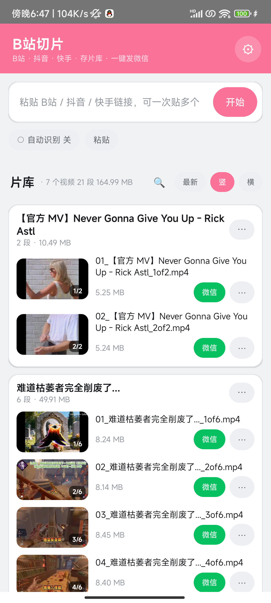

# ClipSmith · 片匠

> 把长视频切成「刚好能发出去」的小段 —— 全程在手机上完成。

Android 9+ · 无 Gradle · 无第三方依赖 · APK 不到 300 KB



## 为什么会有这个东西

微信发视频有体积限制，一段十几分钟的录屏根本发不出去。
常规做法是「下到电脑 → 剪辑软件切一段 → 传回手机」，来回好几趟很烦。

片匠把整条链路塞进手机：

**贴链接（或直接选手机里的视频）→ 自动压缩切段 → 存进相册 → 一键发微信**

## 能做什么

| 能力 | 说明 |
|---|---|
| 链接直取 | B站 / 抖音 / 快手分享链接自动解析；B站多分P、合集可一次勾选多集排队下载 |
| 本地视频 | 相册、录屏里的视频直接切，不用先上传 |
| 按体积切段 | 每段不超过 N MB（默认 9.6，微信友好），切点自动吸附关键帧 |
| 整条压到指定大小 | 填 12 就整条一个文件 ≤12 MB，不再分段；本来就够小则只裁剪不重编码 |
| 裁头裁尾 | 跳过开头 N 秒 / 裁掉结尾 N 秒，**先裁再压**，片头不浪费算力 |
| 片库 | 按视频分组、缩略图、搜索、按组分选批量删除、微信「已发」标记与筛选 |
| 一键发微信 | 单段发 / 整组多选发 / 朋友圈；发过的自动标灰，避免重复发 |
| 后台队列 | 处理中可以继续丢任务进来，自动排队；通知栏显示进度、可取消 |

## 有多快

实测于骁龙 778G（红米 12T），硬件编码 H.264：

| 素材 | 耗时 | 折合 |
|---|---|---|
| 1920×1200 / 20s → 848×528 @855k | 2.3s | 8.7× 实时 |
| 848×576 / 37s → 同分辨率 @855k | 2.9s | 12.7× 实时 |
| 不需要压缩（仅切分） | 0.002s / 每秒视频 | 约 500× 实时 |

换算：6 分钟 1200p 录屏约 41 秒；去掉前 28 秒后约 38 秒。

## 构建

不依赖 Gradle。需要：

- JDK 17
- Android SDK build-tools 34（`aapt2` / `d8` / `zipalign` / `apksigner`）
- Python 3（仅用于把 dex 塞进 APK）

```bash
export ANDROID_SDK_ROOT=/path/to/android-sdk
bash build.sh
# 产物：clipsmith.apk
```

流程是一条直线：`aapt2 compile → aapt2 link → javac → d8 → 打包 → zipalign → apksigner`。
首次运行会自动生成 `debug.jks` 自签证书（已 gitignore，不是发布用）。

## 实现上的几个取舍

- **不用 Gradle / AndroidX**：界面全部用系统控件手写。构建快、APK 小，代价是没有现成组件库可抄。
- **显式挑硬件编码器**：`MediaCodec.createEncoderByType` 在部分机型上给的是 `c2.android.avc.encoder`（纯软编），
  所以改成遍历 `MediaCodecList` 优先取 `isHardwareAccelerated()` 的编码器 —— 这一步让转码快了 4 倍多。
- **转码路径会记忆**：先试「解码器直连编码器表面」（Surface 直通），失败才退到 ByteBuffer 通道，
  结果写进 SharedPreferences，下次不再重复试。
- **缩放不能逐像素读写 ByteBuffer**：`put(下标, get(下标))` 每个像素两次边界检查，
  会让降分辨率比不缩放慢 2.6 倍。改成「整行取进 byte[] → 预计算映射表 → 整行写回」后恢复正收益。
- **目标码率要留余量**：CBR 实际输出比理论值高 10~15%（关键帧开销），按理论值算会把 12MB 压成 12.4MB，又得多切一段。
- **切点吸附关键帧**：按时间均分后对齐到最近的 sync frame，否则每段开头会花屏。
- **片库走 `MediaStore.Video`**：`MediaStore.Downloads` 在安卓 11+ 只能看到本应用写入的文件，
  换成视频集合（配合 `READ_MEDIA_VIDEO`）才能列出外部拷进来的片段。

## 已知限制

- 只输出 H.264 + AAC；H.265/AV1 源会被转成 H.264。
- 1080p 以上主要耗时在硬解（约 200 fps 上限），靠软件优化已经没有空间。
- 少数机型的 Surface 直通不可用，只能走 ByteBuffer 通道，速度约为前者一半。
- **后台复制链接依赖无障碍服务**：Android 10+ 不允许后台应用读剪贴板，
  只能靠无障碍监听「复制」点击。注意：在最近任务里划掉本应用（或强行停止）会让系统
  关闭它的无障碍服务，需要重新开启 —— 主界面顶部会给出提示。

## 更多

每个版本的踩坑记录都在 [docs/DEVLOG.md](docs/DEVLOG.md)。

## 免责声明

仅供个人备份、整理自己有权观看或录制的内容。请遵守各平台服务条款与著作权法，
不要用于二次分发他人作品或任何商业用途。
